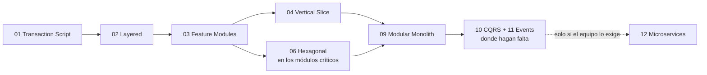

<div align="center">

# 🏛 Software Architecture

**12 arquitecturas de backend, de la más simple a la más compleja.**<br>
El mismo problema resuelto 12 veces, en NestJS, Go y Rust.

[Ruta de estudio](#-ruta-de-estudio) · [Comparativa](#-comparativa) · [¿Cuál elijo?](#-cuál-elijo) · [Ejecutar](#-ejecutar-los-proyectos) · [Glosario](#-glosario) · [Resumen](./RESUMEN.md)

</div>

---

## 👋 Para quién es

Para quien ya sabe construir una API y quiere entender **cómo organizarla**: qué opciones existen, qué problema resuelve cada una y cuánto cuesta mantenerla.

No necesitas experiencia previa en arquitectura. Sí conviene conocer al menos uno de los tres lenguajes y saber qué es un endpoint, un controller y un service.

**Al terminar podrás:**

- Reconocer la arquitectura de un proyecto con solo ver sus carpetas.
- Explicar la diferencia entre Hexagonal, Onion y Clean Architecture (y por qué importa menos de lo que parece).
- Elegir una arquitectura según el tamaño del proyecto y del equipo, y defender la elección.
- Mejorar un proyecto existente por partes, sin reescribirlo.

## 🧩 El caso de estudio

Todos los proyectos resuelven lo mismo: **emitir una póliza de seguro**. Hay que validar que la vigencia sea correcta, que el número no esté repetido, guardar la póliza y avisar que se emitió.

Es un caso pequeño a propósito. Como el problema nunca cambia, lo único que varía entre un proyecto y otro es la arquitectura.

| Petición | Respuesta |
|---|---|
| `POST /policies` con `{"number","startDate","endDate"}` | `201` con `{"id"}` |
| La misma, con `endDate` anterior o igual a `startDate` | `400` |
| La misma, con un `number` que ya existe | `409` |
| `GET /policies/:id` | `200` con la póliza, o `404` |

Los datos se guardan en memoria. Así ningún proyecto necesita base de datos y la atención queda en la estructura.

## 🧭 Ruta de estudio

Sigue el orden: cada arquitectura responde a un problema de la anterior.

### Nivel 1 · Fundamentos

Cómo se organiza el código cuando todavía es poco. Aquí empieza casi todo proyecto.

| # | Arquitectura | La idea en una línea | Complejidad |
|---|---|---|:-:|
| 01 | [**Transaction Script**](./01-transaction-script/README.md) | Un procedimiento por operación, de arriba a abajo | ⭐ |
| 02 | [**Layered Architecture**](./02-layered/README.md) | Capas horizontales: controllers, services, entities | ⭐ |
| 03 | [**Feature Modules**](./03-feature-modules/README.md) | Las mismas capas, agrupadas por feature de negocio | ⭐⭐ |

### Nivel 2 · Organizar por negocio

Qué hacer cuando los services crecen sin control y cuesta encontrar las cosas.

| # | Arquitectura | La idea en una línea | Complejidad |
|---|---|---|:-:|
| 04 | [**Vertical Slice**](./04-vertical-slice/README.md) | Un caso de uso por archivo, con todo lo que necesita | ⭐⭐ |
| 05 | [**Screaming Architecture**](./05-screaming/README.md) | Las carpetas cuentan el negocio, no el framework | ⭐⭐ |

### Nivel 3 · Proteger el dominio

Tres variantes de una misma idea: las reglas de negocio no dependen de la base de datos ni del framework.

| # | Arquitectura | La idea en una línea | Complejidad |
|---|---|---|:-:|
| 06 | [**Hexagonal**](./06-hexagonal/README.md) | Ports & Adapters: el núcleo define interfaces, lo externo las implementa | ⭐⭐⭐ |
| 07 | [**Onion**](./07-onion/README.md) | Anillos concéntricos con el modelo de dominio al centro | ⭐⭐⭐ |
| 08 | [**Clean Architecture**](./08-clean/README.md) | Cuatro círculos y una regla estricta de dependencias | ⭐⭐⭐⭐ |

### Nivel 4 · Escalar el sistema y el equipo

Cómo partir un sistema grande y cómo se comunican sus partes.

| # | Arquitectura | La idea en una línea | Complejidad |
|---|---|---|:-:|
| 09 | [**Modular Monolith**](./09-modular-monolith/README.md) | Un solo despliegue, módulos con fronteras estrictas | ⭐⭐⭐⭐ |
| 10 | [**CQRS**](./10-cqrs/README.md) | Un modelo para escribir y otro para leer | ⭐⭐⭐⭐ |
| 11 | [**Event-Driven y Event Sourcing**](./11-event-driven-event-sourcing/README.md) | Las partes publican hechos y otras reaccionan | ⭐⭐⭐⭐ |
| 12 | [**Microservices**](./12-microservices/README.md) | Servicios pequeños que se despliegan por separado | ⭐⭐⭐⭐⭐ |

### Complemento

| | Tema | Contenido |
|---|---|---|
| 🎨 | [**Frontend**](./frontend/README.md) | Seis arquitecturas de frontend y cómo combinarlas con el backend |
| 📄 | [**Resumen**](./RESUMEN.md) | Todo en una página, para repasar |

### Cómo estudiar cada arquitectura

1. Lee su `README.md` (5 a 10 minutos): idea, lo mejor, lo peor, costo de mantenimiento y cuándo usarla.
2. Abre el proyecto en tu lenguaje y sigue una petición `POST /policies` de principio a fin.
3. Ejecútalo y pruébalo con `curl`.
4. Haz el ejercicio: **añade un endpoint para cancelar una póliza**. Cuenta cuántos archivos tocaste y cuántos creaste. Ese número es el costo real de la arquitectura.
5. Repite el ejercicio en la siguiente y compara.

## 🗺 Cómo se relacionan

No son 12 opciones excluyentes. Responden a cuatro preguntas distintas, y un proyecto real combina una respuesta de cada una.

| Pregunta | Opciones |
|---|---|
| ¿Cómo nombro y agrupo las carpetas? | Por tipo técnico (02) · por feature (03, 04, 05) |
| ¿Hacia dónde apuntan las dependencias? | Hacia la base de datos (01 a 03) · hacia el dominio (06, 07, 08) |
| ¿En cuántas piezas despliego? | Una (monolith) · una con fronteras internas (09) · muchas (12) |
| ¿Cómo viaja la información? | Llamadas directas · lectura y escritura separadas (10) · eventos (11) |

El camino habitual de un proyecto que crece:



Cada flecha es un paso que se da **cuando duele**, no antes. La mayoría de los proyectos nunca necesita llegar al final.

## 📊 Comparativa

Costo de cada tarea: 🟢 bajo · 🟡 medio · 🔴 alto.

| # | Arquitectura | Añadir feature | Modificar | Corregir bug | Cambiar DB o proveedor | Curva de aprendizaje |
|---|---|:-:|:-:|:-:|:-:|:-:|
| 01 | Transaction Script | 🟢 | 🟡 | 🟢 | 🔴 | 🟢 |
| 02 | Layered | 🟢 | 🟡 | 🟢 | 🔴 | 🟢 |
| 03 | Feature Modules | 🟢 | 🟢 | 🟢 | 🔴 | 🟢 |
| 04 | Vertical Slice | 🟢 | 🟢 | 🟢 | 🟡 | 🟢 |
| 05 | Screaming | 🟢 | 🟢 | 🟢 | depende | 🟢 |
| 06 | Hexagonal | 🟡 | 🟢 | 🟢 | 🟢 | 🟡 |
| 07 | Onion | 🟡 | 🟢 | 🟢 | 🟢 | 🟡 |
| 08 | Clean | 🔴 | 🟢 | 🟡 | 🟢 | 🔴 |
| 09 | Modular Monolith | 🟡 | 🟢 | 🟢 | 🟢 | 🟡 |
| 10 | CQRS | 🟡 | 🟢 | 🟡 | 🟡 | 🟡 |
| 11 | Event-Driven / Event Sourcing | 🟡 | 🔴 | 🔴 | 🟡 | 🔴 |
| 12 | Microservices | 🔴 | 🔴 | 🔴 | 🟢 | 🔴 |

Lo mejor y lo peor de cada una, en una línea:

| # | Arquitectura | 👍 Lo mejor | 👎 Lo peor |
|---|---|---|---|
| 01 | Transaction Script | Rapidez, cero ceremonia | Reglas duplicadas, difícil de probar |
| 02 | Layered | Todo el mundo la conoce | Cada feature queda repartida en varias carpetas |
| 03 | Feature Modules | Lo que cambia junto vive junto | Fronteras débiles entre módulos |
| 04 | Vertical Slice | Añadir no rompe lo existente | Duplicación si falta criterio |
| 05 | Screaming | El árbol de carpetas explica el negocio | Por sí sola no define dependencias |
| 06 | Hexagonal | Negocio probado sin infraestructura | Más archivos y mapeo de datos |
| 07 | Onion | Modelo de dominio rico | Más capas sobre las que decidir |
| 08 | Clean | Independencia total del framework | La que más código repetitivo genera |
| 09 | Modular Monolith | Orden de microservices sin su costo | Exige disciplina y herramientas |
| 10 | CQRS | Lecturas simples, escrituras enfocadas | Más piezas que mantener sincronizadas |
| 11 | Event-Driven / Event Sourcing | Desacople y auditoría completa | Flujo difícil de seguir y depurar |
| 12 | Microservices | Equipos y despliegues independientes | Operar un sistema distribuido |

## 🤔 ¿Cuál elijo?

| Tu situación | Arquitectura recomendada |
|---|---|
| Un script, un webhook, un prototipo, un CRUD de pocas tablas | [Transaction Script](./01-transaction-script/README.md) |
| API pequeña, de 1 a 3 personas | [Layered](./02-layered/README.md) o [Feature Modules](./03-feature-modules/README.md) |
| API de negocio típica, en crecimiento | [Feature Modules](./03-feature-modules/README.md) + [Vertical Slice](./04-vertical-slice/README.md) en los módulos grandes |
| Reglas complejas e integraciones con sistemas externos | Lo anterior + [Hexagonal](./06-hexagonal/README.md) solo en los módulos críticos |
| Sistema grande, uno o varios equipos | [Modular Monolith](./09-modular-monolith/README.md) |
| Reportes y pantallas de consulta pesadas | Añade [CQRS](./10-cqrs/README.md) en su versión ligera |
| Muchos efectos secundarios (notificar, auditar, sincronizar) | Añade [eventos](./11-event-driven-event-sourcing/README.md) en proceso |
| Varios equipos que se estorban al desplegar | Extrae [Microservices](./12-microservices/README.md) desde el Modular Monolith |

**Tres reglas para decidir:**

1. **La complejidad de la arquitectura sigue a la del dominio.** Un catálogo CRUD no merece el mismo tratamiento que un motor de cálculo.
2. **Se decide por módulo, no por proyecto.** Un mismo sistema puede tener módulos en tres capas y otros en Hexagonal.
3. **Se sube de nivel cuando duele.** Añadir arquitectura es fácil; quitarla, no.

### ¿Qué arquitectura tengo ya?

Mira la carpeta `src/` de tu proyecto:

| Si ves... | Estás usando |
|---|---|
| Handlers con consultas a la base de datos dentro | Transaction Script |
| `controllers/`, `services/`, `models/` en la raíz | Layered |
| `users/`, `orders/`, `payments/` y dentro de cada una sus controllers y services | Feature Modules |
| Carpetas o archivos con nombre de acción: `create-order/`, `cancel-order/` | Vertical Slice |
| `domain/`, `application/`, `infrastructure/` | Hexagonal, Onion o Clean |
| `commands/` y `queries/` | CQRS |
| Varias apps con su propia base de datos | Microservices |

Si empezaste "creando rutas, controllers, modelos y services" sin pensar en un nombre, lo tuyo es Layered Architecture. Es un buen comienzo y tiene un camino de mejora claro.

## 🚀 Ejecutar los proyectos

Todos los comandos se ejecutan desde esta carpeta (`software-architecture/`). Cada proyecto escucha en el puerto `3000`; cámbialo con la variable `PORT`.

<details open>
<summary><b>NestJS (TypeScript)</b></summary>

Requiere Node 22+ y pnpm 10+.

```bash
pnpm install                              # una sola vez, instala los 12 proyectos
pnpm --filter arq-06-hexagonal build
pnpm --filter arq-06-hexagonal start
```

El nombre del paquete es `arq-` más el nombre de la carpeta: `arq-01-transaction-script`, `arq-02-layered`, ...

</details>

<details>
<summary><b>Go</b></summary>

Requiere Go 1.24+. No usa dependencias externas, solo la biblioteca estándar.

```bash
cd 06-hexagonal/go
go run ./cmd/api
```

</details>

<details>
<summary><b>Rust</b></summary>

Requiere Rust 1.92+. La primera compilación descarga las dependencias y tarda unos minutos.

```bash
cargo run -p arq-06-hexagonal
```

</details>

**Probar cualquiera de ellos:**

```bash
# Emitir una póliza → 201 {"id":"..."}
curl -i -X POST localhost:3000/policies \
  -H "content-type: application/json" \
  -d '{"number":"POL-001","startDate":"2026-01-01","endDate":"2026-12-31"}'

# Consultarla → 200
curl -i localhost:3000/policies/<id>
```

Algunos proyectos tienen endpoints adicionales (09, 10 y 11) o dos servicios (12). El README de cada proyecto lo indica.

## 📖 Glosario

Los términos se usan en inglés a lo largo de la guía, que es como los vas a encontrar en documentación y entrevistas.

| Término | Traducción | Qué significa |
|---|---|---|
| **Adapter** | Adaptador | Código que conecta el núcleo con algo externo: HTTP, base de datos, correo |
| **Aggregate** | Agregado | Grupo de objetos de dominio que se guarda y se valida como una unidad |
| **Bounded context** | Contexto delimitado | Parte del negocio con su propio modelo y vocabulario |
| **Boilerplate** | — | Código repetitivo que hay que escribir sin que aporte lógica |
| **Command** | Comando | Petición que cambia el estado del sistema |
| **CRUD** | — | Crear, leer, actualizar y borrar: operaciones sin reglas de negocio |
| **DDD** (Domain-Driven Design) | Diseño guiado por el dominio | Modelar el software con el lenguaje y las reglas del negocio |
| **Dependency rule** | Regla de dependencia | El código de negocio no conoce a la infraestructura; es al revés |
| **Domain** | Dominio | El negocio que el software resuelve, con sus reglas |
| **DTO** (Data Transfer Object) | — | Objeto que solo transporta datos entre capas o por la red |
| **Entity** | Entidad | Objeto de dominio con identidad propia (una póliza, un cliente) |
| **Event** | Evento | Registro de algo que ya ocurrió: "póliza emitida" |
| **Eventual consistency** | Consistencia eventual | Los datos coinciden tras un breve retraso, no al instante |
| **Facade** | Fachada | Interfaz pequeña y pública que oculta el interior de un módulo |
| **Feature** | Funcionalidad | Capacidad del sistema con valor para el usuario |
| **Handler** | Manejador | Función o clase que atiende una petición, un command o un event |
| **Idempotent** | Idempotente | Ejecutarlo dos veces produce el mismo resultado que una |
| **Monolith** | Monolito | Aplicación que se despliega como una sola pieza |
| **Outbox** | — | Tabla donde se guardan los events junto con los datos, para no perderlos |
| **Port** | Puerto | Interfaz que el núcleo define para hablar con el exterior |
| **Query** | Consulta | Petición que lee datos sin cambiar nada |
| **Read model** | Modelo de lectura | Datos preparados a la medida de una consulta |
| **Repository** | Repositorio | Abstracción para guardar y recuperar objetos de dominio |
| **Use case** | Caso de uso | Una acción completa que el sistema ofrece: "emitir póliza" |
| **Value object** | Objeto de valor | Objeto sin identidad, definido por su contenido: una fecha, un importe |

## 📚 Para profundizar

**Artículos originales** (cortos y de lectura obligada):

| Arquitectura | Autor | Enlace |
|---|---|---|
| Hexagonal | Alistair Cockburn | [Hexagonal Architecture](https://alistair.cockburn.us/hexagonal-architecture/) |
| Onion | Jeffrey Palermo | [The Onion Architecture](https://jeffreypalermo.com/2008/07/the-onion-architecture-part-1/) |
| Clean | Robert C. Martin | [The Clean Architecture](https://blog.cleancoder.com/uncle-bob/2012/08/13/the-clean-architecture.html) |
| Screaming | Robert C. Martin | [Screaming Architecture](https://blog.cleancoder.com/uncle-bob/2011/09/30/Screaming-Architecture.html) |
| Vertical Slice | Jimmy Bogard | [Vertical Slice Architecture](https://www.jimmybogard.com/vertical-slice-architecture/) |
| CQRS | Martin Fowler | [CQRS](https://martinfowler.com/bliki/CQRS.html) |
| Event Sourcing | Martin Fowler | [Event Sourcing](https://martinfowler.com/eaaDev/EventSourcing.html) |
| Microservices | James Lewis y Martin Fowler | [Microservices](https://martinfowler.com/articles/microservices.html) |
| Modular Monolith | Martin Fowler | [Monolith First](https://martinfowler.com/bliki/MonolithFirst.html) |

**Libros:**

| Libro | Autor | Para qué |
|---|---|---|
| *Patterns of Enterprise Application Architecture* | Martin Fowler | Transaction Script, Layered, Repository y los patrones base |
| *Clean Architecture* | Robert C. Martin | La regla de dependencia y sus motivos |
| *Domain-Driven Design* | Eric Evans | El libro original de DDD |
| *Implementing Domain-Driven Design* | Vaughn Vernon | DDD llevado a código |
| *Building Microservices* | Sam Newman | Microservices, con sus costos explicados sin adornos |

---

<div align="center">

[← Volver a study-code](../README.md) · [Empezar por Transaction Script →](./01-transaction-script/README.md)

</div>
